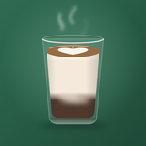
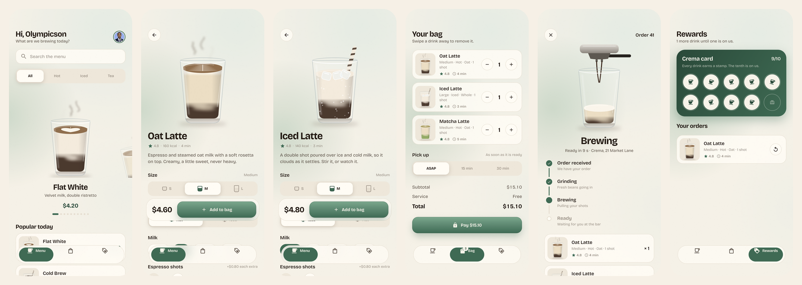
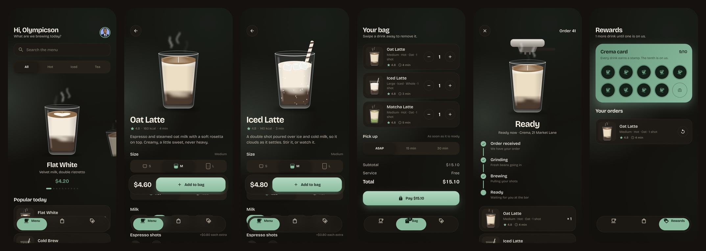

<p align="center">
  
</p>

<h1 align="center">Crema</h1>

<p align="center">
  A Flutter coffee ordering app where every drink is poured in code. Pick
  a size, switch to iced, change the milk, and watch the glass re-pour.
</p>

<p align="center">
  <a href="https://flutterzip.com"></a>
  <a href="https://instagram.com/flutter_zip"></a>
  
  
  
  
  
</p>

<p align="center">
  
</p>
<p align="center">
  
</p>

## Highlights

- **A glass of coffee drawn in code.** Espresso, milk and foam are real
  layers with soft edges, milk clouds drift through the coffee, latte art
  (heart, rosetta, tulip) sits on the foam, steam curls up from hot drinks,
  and iced ones get bobbing ice, a striped straw and beads on the glass.
- **It re-pours as you choose.** Size, hot or iced, milk, shots: each
  change blends the drink to its new levels and the surface sloshes on an
  underdamped spring, then settles.
- **A wheel of drinks.** The menu's cups stand tall in the middle and
  shrink, sink and lean away at the sides, with the name and price sliding
  under your finger, not on the page change.
- **Add to bag flies.** The cup lifts off, arcs into the bag icon with
  fading ghosts behind it, the icon squashes and the badge ticks on arrival.
- **Watch your order being made.** Beans tumble into the machine while it
  grinds, two streams pour from the spouts, the glass fills, and the art
  appears when it is ready. It all runs from the clock, live.
- **A stamp card that stamps itself.** New stamps drop in one by one, land
  askew and spread a ring of ink, with a haptic tap each.
- **Prices that roll** digit by digit, a sugar picker whose cubes drop in,
  a size picker with tiny glasses, swipe to remove with undo, reorder from
  history, light and dark from one palette file.

## Try the demo

- Spin the wheel and tap the middle cup. Change the size, go iced, try
  every milk, add shots, then **Add to bag**.
- In the bag, swipe a drink away and tap **Undo**. Pick a pickup time and
  pay. The order page shows the coffee being made; it is ready in about
  26 seconds (a later pickup waits until then).
- Rewards: the card starts at 6 stamps. Order four drinks to fill it and
  redeem one. Reorder anything from your history.
- The round button on the right edge opens **Demo settings**: theme and
  reset demo data.

## Getting started

```bash
git clone https://github.com/flutterzip/crema.git
cd crema
flutter pub get
flutter run
```

Open a screen straight away: `--dart-define=startRoute=drink` (also `bag`,
`order`, `rewards`). `--dart-define=timingScale=0` skips every wait.

## Make it yours

| To change | Edit |
|---|---|
| Every UI colour, light and dark | `lib/config/palette.dart` |
| The coffee colours (espresso, milks, foam, ice) | `lib/widgets/cup/drink_colors.dart` |
| The menu: names, prices, layers, latte art | `assets/data/drinks.json` |
| The person, their store and starting stamps | `assets/data/profile.json` |
| Sizes, milks and what they cost | `lib/data/models.dart` |
| How long an order takes at the bar | `AppTiming.orderStages` in `lib/config/timing.dart` |
| How things move | `lib/config/motion.dart` |
| The app's name and tagline | `lib/config/brand.dart` |

## Project structure

```
lib/
  config/     palette, theme, motion, timing, brand
  data/       drinks, options, bag lines, orders, money
  state/      the seed, bag, orders and rewards (Riverpod, saved locally)
  widgets/    everything screens are built from
    cup/      the glass: drink model, painter, widget
    widgets.dart  one import for a screen
  screens/    menu, drink, bag, order, rewards, shell, splash
  demo/       Demo settings button and launch hooks
```

## How it is built

The cup is a `CustomPainter` on a 200 by 262 design canvas. A drink is a
`DrinkArt`: numbers and colours (how much espresso, milk and foam, how
full, hot or iced, which art), so any two drinks can be blended. The `Cup`
widget keeps the drink it is showing and the one it is heading to, runs
one ticker for the pour, the slosh spring and the ambient steam and ice,
and stops it when nothing is moving.

Each drink's look comes from its seed row plus your options
(`Drink.pour(options)`), and its price the same way
(`Drink.priceWith(options)`), so the cup and the price can never disagree.
Order status is never stored: `stageOf(order, now)` works it out from when
it was placed.

## Testing

```bash
flutter analyze --fatal-infos
flutter test
```

33 tests cover prices and options, pouring, the bag (merging, undo,
saving), orders moving through the bar with the clock, the stamp card and
rewards, every screen, the splash handing over without rebuilding the menu,
and that no on-screen string has an em dash. `tool/shots.sh` takes the
README screenshots on the iOS simulator.

## Made by FlutterZip

A new Flutter UI every day. Follow [@flutter_zip](https://instagram.com/flutter_zip)
and find more at [flutterzip.com](https://flutterzip.com).

## Credits

- [Bricolage Grotesque](https://github.com/ateliertriay/bricolage) by
  Mathieu Triay, SIL Open Font License 1.1 (`assets/fonts/OFL.txt`).
- The glasses, coffee, machine, stamps and icon are drawn in code for this
  project.

## License

MIT. See [LICENSE](LICENSE).
